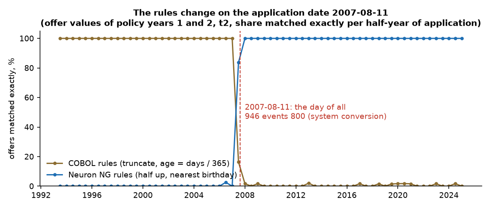
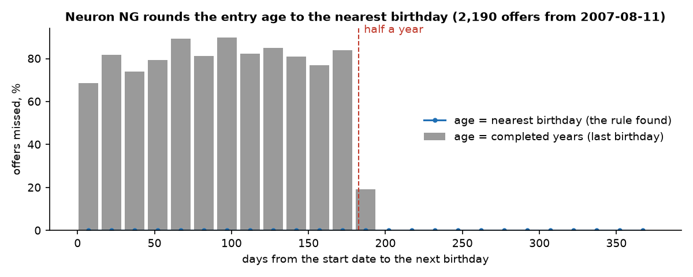
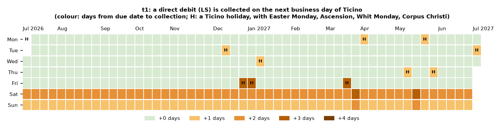
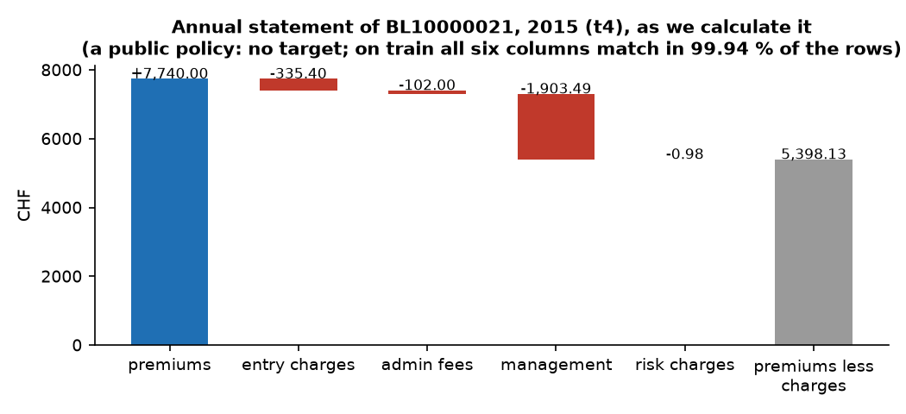
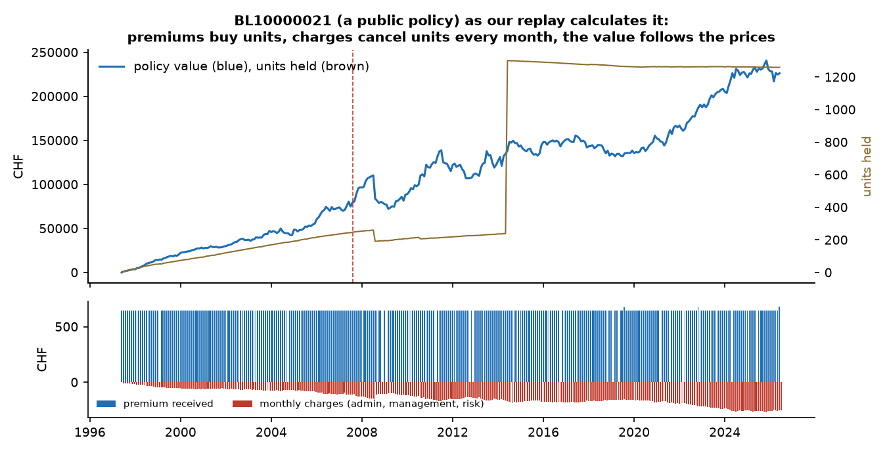
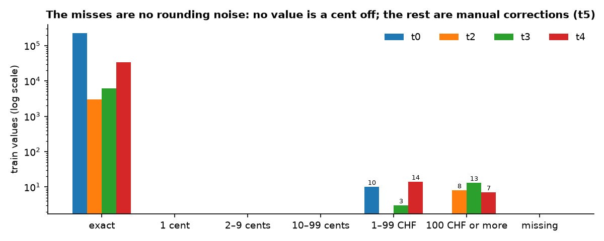
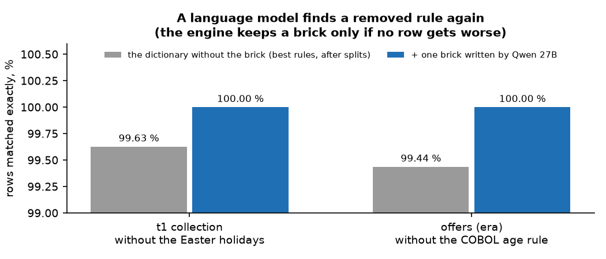
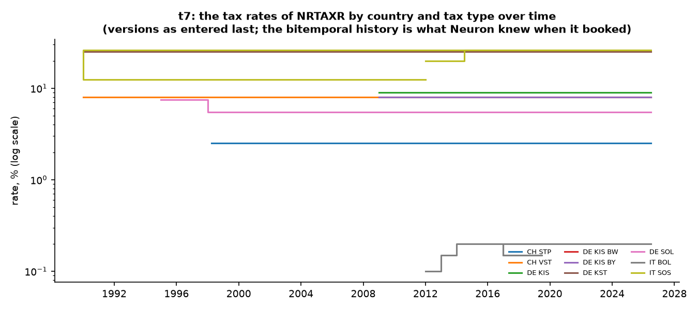
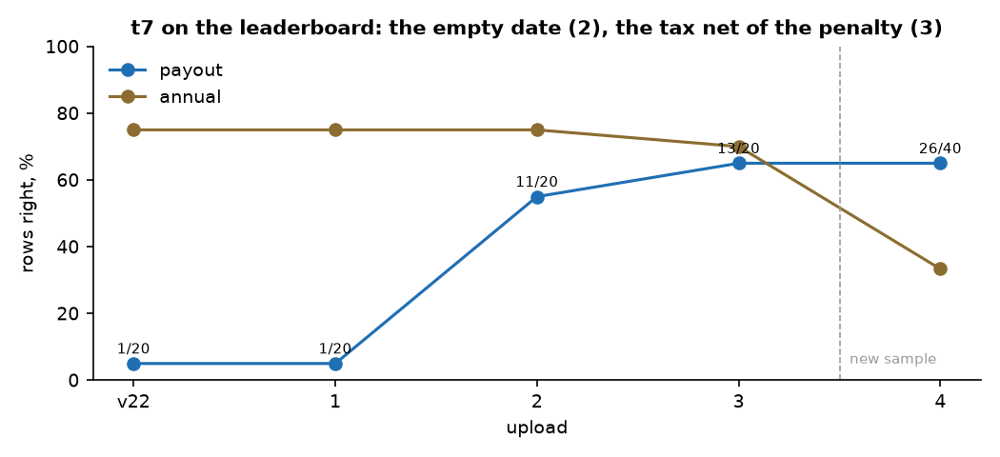

# Figures (t6): the hidden rules, made visible

Made by `tools/figures.py` from `legacy/` and the train targets (`pip install -r tools/requirements.txt`, then
`.venv/bin/python tools/figures.py`; matplotlib
is used only here, never in `my_solution`). Each figure shows one rule the search found and the rows that decide it. The figures show our values (of public
policies, which have no target) or shares and counts of the comparison, never a target value.

| Figure | What it shows |
|---|---|
|  | **The system change.** Offer values of years 1 and 2 matched by the COBOL rules (truncate, age = days / 365) and by the Neuron NG rules (half up, nearest birthday), per half-year of the application date. They swap at once on 2007-08-11, the day of all 946 events 800 (system conversion) — the cut-off the decision tree found and moved onto that landmark. |
|  | **The entry age of Neuron NG.** Counting completed years misses the offers whose next birthday is less than half a year after the start; the nearest birthday misses none. |
|  | **The collection date of a direct debit (t1).** Days from the due date to the collection, for every due date of the year after the extract, as we calculate it (all 15,028 train dates match): weekends move to Monday, the holidays of Ticino (with the four that follow Easter) to the next business day. |
|  | **An annual statement (t4)** as a waterfall, as we calculate it for a public policy: the premiums of the year less the entry charges, admin fees, management and risk charges. |
|  | **One policy over its life (t3)**, the same public policy as our replay calculates it: the premiums received, the monthly charges, the units held and the policy value; the dashed line is the system change. |
|  | **Our values against the targets.** Every value is exact or off by a franc or more — never by a cent: the misses are not rounding, they are the manual corrections of t5. |
|  | **The language model in the loop.** A rule was removed from the dictionary; the engine was left with its best split rules, Qwen 27B proposed one brick, and the engine kept it because no row got worse: 100 % again. |
|  | **t7: the tax rates of NRTAXR** by country and tax type over time (CH stamp duty and withholding tax, IT substitute tax and stamp duty, DE capital gains tax, solidarity surcharge and church tax). |
|  | **t7 on the leaderboard:** the rows right per upload; the empty remittance date (upload 2) and the tax net of the surrender penalty (3) moved payout; upload 4 is on a new sample. |
