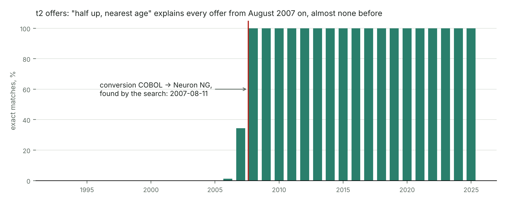

# Vocabulary: a dictionary of legacy conventions and an exhaustive rule search

The submission contains the rules. This tool shows how the rules can be found by a machine, and
how the same search works on a target nobody has studied yet.

## How it works

1. **A formula with holes.** The business logic of a target is written as a formula whose unknown
   parts are holes, e.g. `rounding(amount × rate(tier on ??? date))`.
2. **A dictionary of bricks** (`bricks.py`). Each hole has a family of conventions a legacy system
   may have used: 7 roundings (one of them "truncate before the 2007 conversion, half up after"),
   5 age rules, 6 business-day shifts with the holidays of Ticino, 3 day counts, 2 growth rules.
   Adding an idea means adding one function to a family.
3. **Exhaustive search** (`engine.search`). Every combination of bricks is scored by the share of
   **exact** matches (to the cent, to the day), never by an average error. When two combinations
   score the same, the simpler one wins (each family is ordered from simple to special).
4. **Where does the best rule fail?** (`engine.diagnose`). If the best rule is not exact, a
   one-level decision tree on the hits and misses names the condition behind the misses, for
   example `payment method == 'LS'` or `application date < 2007-08-11`. The rows are split there
   and each part is searched again. A split is kept only if the parts get different rules.
5. **When no brick fits.**
   - Generated families try every rounding mode at 0 to 6 decimals and every date offset
     (−5 to +5 days, 1 to 5 business days).
   - A fitted hole (`Fit`) recovers an unknown constant, such as a rate, from the ratios
     target / input. The exact search then confirms or rejects it.
   - Whatever is still unexplained goes to `outliers.csv` (the candidates for t5), together with a
     prompt for a language model (`<case>_prompt.md`). `llm.py` is where a model plugs in; a proposed
     brick is kept only if it raises the exact matches on held-out policies.
6. **Check and record.** Every rule is checked on 20 % of the policies that the search never saw
   (split by policy). Every search is written to `journal.jsonl`; `report.md` is the summary.

Manual corrections do not mislead the search. Because the score counts exact rows, a corrected
value costs one row and never shifts a parameter. The rows left over are the t5 candidates.

**How to read the output.** Each case prints a tree. A line ending in `/ <condition>` is a part of
the line above it. Only the last line of each branch is part of the final rule; the lines above it
show how the engine got there. The two percentages are the exact matches on the search policies and
on the held-out policies.

## Results on the challenge data

| Case | Combinations | Rule found | Search | Held out |
|---|---|---|---|---|
| t0 commission | 4 dates × 7 roundings | broker on the **money date**, **half up** | 99.995 % | 99.998 % |
| t1 collection date | 6 shifts | split on **payment method**: direct debit → next business day of Ticino (Easter holidays included), bank transfer → same day | 100 % | 100 % |
| t2 offer, years 1–2 | 3 × 4 × 2 × 2 = 48 | truncate before 2007-08-11, then half up; entry age days/365, then nearest; rate / 12; pot 2 rate | 100 % | 100 % |
| t2 offer, **no era brick** | 3 × 3 × 2 × 2 = 36 | the tree finds `application date < 2007-08-11` by itself; before: truncate and days/365, after: half up and nearest age | 100 % | 100 % |
| t3 units of a booking (1 % sample, 52,061 bookings) | 2 × 3 × 3 × 3 = 54 | split on **booking type**: premiums buy at the **issue price** with the FX rate of the **day before the trade**; charges cancel at the **redemption price** with the FX rate of the trade date; 6 decimals, era rounding | 100 % | 100 % |
| t3 surrender penalty | 4 × 2 × 3 = 24 | **completed policy years**, **waivers apply**, era rounding | 99.756 % | 99.678 % |
| t4 premiums per year | 3 item sets × 3 dates = 9 | items **received and not reversed**, by **money date** | 100 % | 100 % |

What is left over is the set of manual corrections. In t0 it is 10 policies: each has a whole
number of francs added, and all 6 policies that NREXCP lists for these rows are among them. In the
surrender penalty it is 16 policies, including all 11 listed ones. These are the same rows the
solution's t5 flags.

Checks: two full runs give identical reports, since the search is deterministic. The t3 units rule
was confirmed again on a 4 % sample (217,372 bookings), with the same two rules at 100 % on both
sides. The seven cases run in about a minute on a laptop.



## Generality: take an input away

`specs/t0_without_rate_table.json` does not read the rate table NRCOMR; the rate is a fitted hole.
From the payments alone (30 % of the policies, 69,555 payments) the engine finds that the rate
depends on the broker tier and the premium type, and recovers every rate of the table. All parts are
100 % on held-out policies, and the 4 policies left over are all listed in NREXCP.

| Tier | Regular (L) | Single (E) |
|---|---|---|
| A | 4 % | 1.5 % |
| B | 3 % | 1 % |
| C | 2 % | 0.5 % |

`specs/ablation/` removes more, one input at a time (results in `results_ablation/`):

| Removed | What the engine did | Result |
|---|---|---|
| the rate table and the premium type column | used the product instead (FLSP is the single-premium product) | all 6 rates recovered, 100 % held out, 4 policies left over, all listed in NREXCP |
| the rate table and the broker tier (NRBROK not read) | the tier is a property of each of the 400 brokers, which no other column carries; no split explains the misses | **no false rule**: best rule 43 %, everything else left over with a prompt |
| the Easter holidays from the dictionary | found the rest of the rule (99.6 % of the direct debits) | left over exactly the collections after Easter Monday, Ascension, Whit Monday and Corpus Christi 2027, listed in the prompt |

So the engine recovers what the data still contains, finds a replacement for a missing column when
one exists, and says so when the information is gone, instead of inventing a rule.

## Run it

From the folder that contains `legacy/` and `targets/`:

```
python3 vocabulary/tests/run_tests.py                                              # self-tests, no data needed
python3 vocabulary/run.py --solution my_solution --out vocabulary/results           # the 7 built-in cases
python3 vocabulary/run.py --spec vocabulary/specs/*.json --out vocabulary/results_spec
python3 vocabulary/run.py --spec vocabulary/specs/ablation/*.json --out vocabulary/results_ablation
```

The self-tests check the bricks against known answers (Easter dates, holidays of Ticino, ages,
roundings) and plant rules in synthetic data that the engine must find back exactly:

1. a rule that switches on a cut-off date;
2. the same through a JSON spec;
3. a rule that is **not in the dictionary** (rate 3.7 %, half even to 3 decimals): the fixed
   dictionary must fail honestly (rows left over and a prompt, no false 100 %), the generated
   families and the fitted rate must find the rule, and the LLM hook must keep a right proposal and
   reject a wrong one;
4. an input that is missing on some rows: the diagnosis must still split correctly;
5. the LLM path end to end: `llm.py` talks to a stand-in server that proposes the missing Easter
   holidays and a wrong brick; the engine must keep the right one and reach 100 %.

Options:

- `--llm` asks `llm.propose` for new bricks where a part stays unexplained (connect a model there).
- `--cases t0_commission t3_units` runs only some built-in cases.
- A spec can set `"sample"` (percent of the policies) and `"depth"` (levels of splits, default 2).
- `RF_SHARE=5` before the command makes the t3 units case use 5 % of the policies.

`--solution` is only used to load the tables (date and number formats, versioned rows, tariff
lookups), not for any rule that is searched. The search uses the Python standard library only;
`figures/change_point.py` needs matplotlib.

## A new target without writing Python: a JSON spec

A spec declares:

- the target file and its keys;
- the rows: a table of the export, the target file itself (`target:<file>`) or any CSV (`csv:<path>`);
- the joins by equal columns (a versioned table is joined as of a date, and that date can itself be a hole);
- the holes: a family of the dictionary, a generated family such as `ROUNDINGS_ANY`, candidate
  expressions, or a constant fitted from the data (`{"fit": "ratio", "of": "num(PR_AMTRC, 2)"}`);
- the formula, as one expression.

`specs/t0_commission.json` is the whole commission task:

```json
"rows": {"from": "NRPREM", "where": "PR_STATE == 'P'", "key": ["PR_POLNR", "int(PR_DUENR)"],
         "join": [{"table": "NRRISK", "on": {"RK_POLNR": "PR_POLNR"}, "where": "RK_RSKNR == '1'"},
                  {"table": "NRPOLH", "on": {"PH_POLNR": "PR_POLNR"}, "as_of": "hole:broker taken on"},
                  {"table": "NRBROK", "on": {"BR_BRKNR": "PH_BRKNR"}},
                  {"table": "NRCOMR", "on": {"CR_TIER": "BR_TIER", "CR_PAYTP": "RK_TARKEY[5]"}, "as_of": "hole:broker taken on"}]},
"holes": {"broker taken on": {"due date": "date(PR_DUEDT)", "money date": "date(PR_RCVDT)"}, "rounding": "ROUNDINGS"},
"formula": "rounding(num(PR_AMTRC, 2) * num(CR_RATE, 6), date(PR_RCVDT))"
```

A spec reads the export itself and needs no solution folder. It gives the same rules as the Python cases.

## A target that needs a simulation

Targets that replay a policy month by month (the offer of t2, the fund accounting of t3 and t4)
need a loop, so they are Python cases. Add `cases/<name>.py` with
`build(legacy, targets) -> rows, slots, formula` and list it in `run.py`:

- `rows`: one dict per target value with `target`, `policy`, `key`, `holdout` and `features` (for the diagnosis);
- `slots`: `{hole: {label: brick}}`, usually families from `bricks.py`;
- `formula(row, choice)`: the business logic with the chosen bricks.

A case may also define `extra_report(rows, formula, slots, out)` to add lines to the report
(`t2_offer_plain` uses it for the change point).

## Where an LLM fits

`llm.py` is the only place. With `--llm`, the engine first runs the normal search. Then, for every
part that stays unexplained, it sends the prompt it also writes to `<case>_prompt.md`: the best rule,
how often it fails, the most frequent missed cases, the bricks already tried and real calls of the
bricks of each hole (so the model sees the arguments and types). The model can call `best(...)`, the
current best brick, so it extends the rule rather than rewriting it.

The model answers with Python functions named `brick`. Each one is compiled with only Decimal,
datetime and safe builtins in reach and dropped if it is too slow. The whole search of the case then
runs again with the proposed bricks in the dictionary. They are kept only if the final rule is never
worse and better somewhere: more exact rows on the held-out policies, or, if those are all exact
already, on the search policies. A wrong brick cannot cost a single row. The report shows the source
of every kept brick, and `llm_proposals.jsonl` logs every request and answer.

`llm.py` talks to any OpenAI-compatible server (our vLLM with Qwen) using the standard library only.
The address and key come from the environment, never from a file in the repository:

```
export VAST_URL="http://<host>:<port>"
export VAST_TOKEN="<key>"
python3 vocabulary/llm.py      # connection check
python3 vocabulary/run.py --llm --spec vocabulary/specs/ablation/t1_no_easter_holidays.json --out vocabulary/results_llm
```

What we saw on the Easter ablation:

- **Our Qwen, first version of the prompt** (no `best`): the model wrote the Easter holidays correctly
  but retyped the fixed holidays of Ticino from memory, with mistakes (it added 25 April and Good Friday, and dropped
  19 March, 29 June, 15 August and 1 November). The engine rejected the brick where it lost rows and
  kept it only for the due dates from 27 March on, where it helps. That left exactly the 7 collections
  after San Pietro e Paolo (29 June), with no false 100 %. The run is in `results_llm_qwen_first/`.
- **A brick that extends `best`** with the four Easter holidays (checked with a stand-in server)
  takes the direct debits from 99.6 % to 100 % with one request.

**Step 10 (2026-10-17), with the safeguards below** (`results_llm_step10/`):

- *A model before a random date split.* A split on a date is made at once only on a business date of the export
  (a day of one kind of event for many policies, the start of a parameter row, a 1 January, `run.py
  plausible_splits`); any other date waits until the model was asked about the whole part. On the Easter ablation the
  split on `due date < 2027-03-27` is no longer made: the direct debits stay one part, and Qwen's first brick takes
  them from 99.6 % to **100 % in one step** (search and held out), extending `best` with the Easter holidays.
- *Rows the rule gets right near the misses.* The prompt also lists exact rows close in date to the missed ones
  ("a new brick must keep them"). The first answers added Good Friday, a holiday in most cantons but not in Ticino;
  with the exact Good Fridays in view, the model left it out.
- *Ablation of the COBOL age rule* (`cases/ablation_era_age.py`): without "days / 365" the offers before
  2007-08-11 stay at 98 % with a misleading split on a tariff date; Qwen proposed "days since birth / 365, rounded",
  the engine kept it, and the COBOL part is exact (100 % / 100 %), the extra split gone.
- *A finding against the engine* (`cases/ablation_t1_anchor.py`): without the anchor day of t1, the best remaining
  rule is right on 99.95 % of the due dates, above the share the engine calls explained (99.9 %); the 4 drifted
  schedules are then reported as candidates for manual corrections, and no model is asked. A dictionary gap that
  small looks like noise.
- *Kept bricks are stored* in `learned.json` with their case, hole, model, effect and the brick they extend
  (`learned.py`), and loaded by later runs of the same case: the run without a model gives the same rules.
  A stored brick is compiled through the sandbox every time, never imported as a module.
- *The sandbox* (`engine.checked`) rejects an import, any dunder name or attribute and any text naming one before
  the code runs with restricted builtins; an empty answer (the reasoning used every token) is asked once more with
  low effort.

Rows that no rule explains stay in `outliers.csv`. The reports kept in git carry no target value: the
`outliers.csv` files are not committed (run again to get them) and the values after "expected" in the saved prompts
are replaced by `[target value removed]` (`tools/target_leaks.py` checks every tracked file, part of the quality gate). A manual correction must never be "explained",
or the rule would not generalise. The final rule never calls a model.

## Files

| File | What it is |
|---|---|
| `bricks.py` | the dictionary: roundings, ages, holidays and business days, day counts, growth, generated families |
| `engine.py` | search, diagnosis and splits, fitted holes, journal, prompts, LLM proposals |
| `spec.py` | turns a JSON spec into rows, holes and a formula |
| `run.py` | command line: runs cases and specs, writes `report.md`, `journal.jsonl`, `outliers.csv`, prompts |
| `llm.py` | the connection to a language model (OpenAI-compatible; off unless `--llm` and the environment are set) |
| `cases/` | the built-in cases t0 to t4 |
| `specs/`, `specs/ablation/` | JSON specs, including the ablation tests |
| `tests/run_tests.py` | self-tests on synthetic data |
| `results*/` | the outputs of the runs above (`results_llm_qwen_first/`: the first run with our Qwen) |
